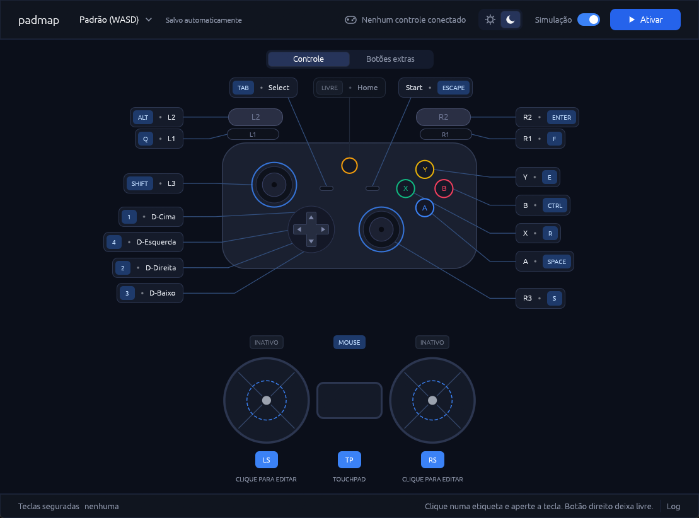
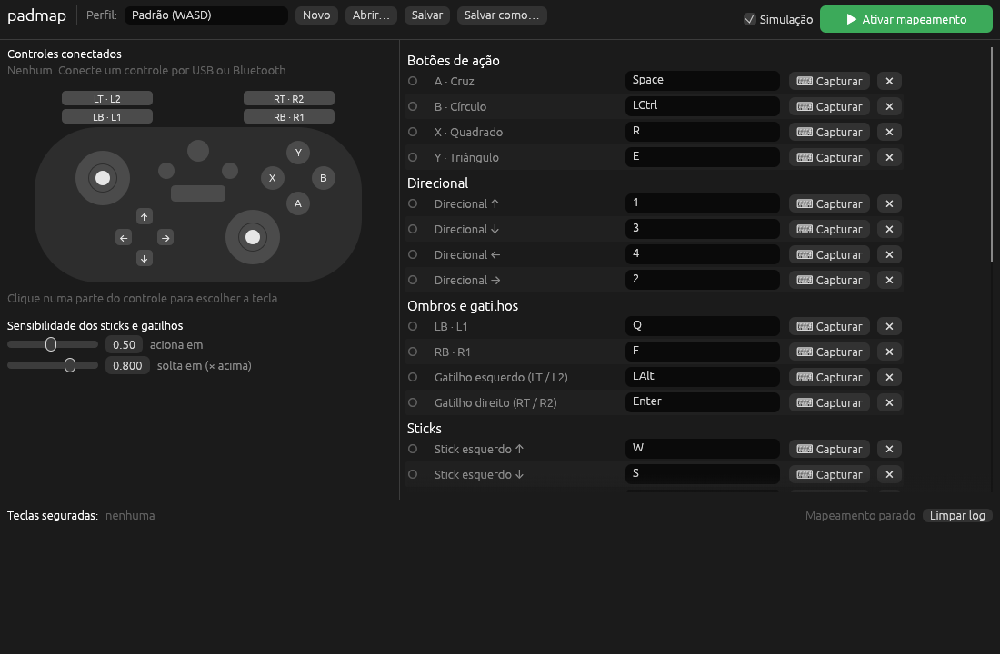

# padmap

[](https://github.com/walter-souza/padmap/actions/workflows/ci.yml)
[](LICENSE)

Mapeia qualquer controle (Xbox, PlayStation, Switch ou genérico) para teclado e
mouse, para jogar com controle o que só aceita teclado. Windows primeiro; Linux
e macOS já compilam.

- Botões, gatilhos, sticks por setores de ângulo e combinações (`Ctrl+S`, `A+B`).
- Stick ou touchpad como mouse, e botões que clicam o mouse.
- Touchpad em zonas, como trackpad ou por gestos.
- Botões extras: traseiros, turbo, modo, qualquer botão que o controle mande.
- Perfis em TOML, editados na interface ou à mão, com modo claro e escuro.

> Estado: primeira versão, em testes com controles reais.



## Baixar

As versões ficam em [Releases](https://github.com/walter-souza/padmap/releases/latest):

- **Windows:** dois jeitos, com o mesmo programa:
  - `padmap-<versão>-windows-x64-setup.exe`, o instalador: atalho no menu
    Iniciar (e, se quiser, na área de trabalho) e desinstalação pelo Windows.
    Instala só para o seu usuário, sem pedir administrador.
  - `padmap-<versão>-windows-x64.exe`, um arquivo só, sem instalar nada (o SDL e
    o runtime do Visual C++ vão dentro dele).

  Como não são assinados, o Windows pode mostrar "O Windows protegeu o
  computador": clique em "Mais informações" e em "Executar assim mesmo".
  Desinstalar não apaga os perfis.
- **Linux:** `padmap-<versão>-linux-x64.tar.gz`, com a interface (`padmap`) e a
  linha de comando (`padmap-cli`).
- **macOS (Apple Silicon):** `padmap-<versão>-macos-arm64.tar.gz`. Na primeira
  vez, abra com clique direito → Abrir.

Veja também as [permissões por sistema](#permissões-por-sistema).

Para compilar você mesmo, veja [Compilando](#compilando).

## Como funciona

1. O SDL3 lê o controle e entrega botões e eixos num layout padrão
   (`south` é A no Xbox, Cruz no PlayStation).
2. Um **perfil** em TOML diz qual tecla cada botão ou eixo aciona.
3. O motor de mapeamento gera "pressiona/solta tecla".
4. Um backend nativo injeta as teclas: `SendInput` no Windows, `uinput` no
   Linux e `CGEvent` no macOS.

Detalhes em [docs/arquitetura.md](docs/arquitetura.md).

## Interface gráfica

```sh
cargo run --release -p padmap-gui
```



- **Controle ao vivo:** o desenho acende os botões, move os sticks e enche os
  gatilhos conforme você mexe no controle. A etiqueta da tecla que está sendo
  enviada fica destacada. O controle conectado aparece no topo.
- **Touchpad:** o touchpad do controle (DualShock 4, DualSense e outros) fica
  entre os dois sticks. Ele só aparece quando o controle conectado tem
  touchpad (ou, sem controle, se o perfil já o mapeia). Clique nele para
  escolher um modo:
  - **Zonas:** o touchpad dividido em zonas (inteiro, metades, colunas,
    quadrantes ou uma grade de até 4 × 3), cada uma com uma tecla. A zona
    aciona ao apertar o touchpad, na zona sob o dedo, ou já ao encostar.
  - **Mouse:** deslizar o dedo move o cursor, como no notebook. Apertar o
    touchpad clica (com dois dedos, o outro clique); as duas teclas podem ser
    trocadas.
  - **Gestos:** deslizar para cima, baixo, esquerda ou direita aperta a tecla
    da direção, que fica apertada até o dedo sair.

  Os dedos aparecem ao vivo no editor. DS4Windows e o "PlayStation Configuration
  Support" do Steam escondem o touchpad dos outros programas: deixe-os
  desligados.
- **Botões extras:** a aba "Botões extras", acima do desenho, aceita qualquer
  outro botão do controle: traseiros, turbo, modo, botões sem nome. Clique em
  "Adicionar botão", aperte o botão no controle, dê uma tecla e, se quiser, um
  nome. A linha acende enquanto o botão está apertado, o que ajuda a descobrir
  qual é qual. Se o controle transformar o botão num outro já conhecido (o de
  trás vira "A", por exemplo), nenhum programa consegue diferenciar; o padmap
  avisa quando o botão apertado já está no desenho.
- **Mapear:** cada botão tem uma etiqueta ligada a ele por uma linha. Clique na
  etiqueta (ou no próprio botão do desenho), segure a tecla ou as teclas juntas
  (`Ctrl+S`, `A+B`) e solte: a combinação vale ao soltar tudo. Para um clique
  do mouse, use os botões Esquerdo, Direito ou Meio do modal (segure Ctrl,
  Shift ou Alt antes para combinar). O clique fica apertado enquanto o botão do
  controle estiver apertado, então dá para arrastar. Botão direito na etiqueta,
  ou "Deixar livre" no modal, deixa o botão livre.
- **Sticks:** os dois círculos embaixo mostram em amarelo o setor que está
  acionando uma tecla. Clique num deles (ou em LS / RS) para abrir o
  **Mapeamento do Stick**, que tem dois modos (seletor no topo):
  - **Teclas:** o círculo do stick dividido em setores, cada um com sua tecla.
    Arraste as alças para mudar as divisas, clique num setor e aperte a tecla,
    botão direito deixa o setor livre. Também tem presets de 4 e 8 direções, a
    zona morta do stick e o disparo compartilhado (setores vizinhos acionam
    juntos na diagonal; com ele ligado, o círculo mostra em faixas suaves onde
    isso acontece).
  - **Mouse:** o stick move o cursor. Ajuste a velocidade (pixels por segundo
    com o stick no fim do curso), a precisão (curva: mais precisão deixa o
    começo do curso lento, para mirar), a zona morta e a inversão do Y, ou use
    um dos presets. A área de teste mostra um cursor andando com o stick, na
    velocidade real, sem precisar ativar o mapeamento. Os setores ficam
    guardados para quando você voltar às teclas.

  Nos dois modos dá para trocar os eixos que o stick usa.
- **Testar sem risco:** com "Simulação" ligada, "Ativar mapeamento" só mostra
  no log as teclas que seriam enviadas. Desligue para enviar de verdade. O log
  abre pelo botão "Log" no rodapé.
- **Perfis:** ficam numa pasta do padmap (no Windows,
  `%APPDATA%\padmap\data\perfis`; no Linux, `~/.local/share/padmap/perfis`; no
  macOS, `~/Library/Application Support/padmap/perfis`), e o padmap reabre o
  último usado. Clique no nome do perfil para ver a lista, com busca: um clique
  troca de perfil. O "•••" de cada perfil tem Renomear (o arquivo acompanha o
  nome), Duplicar, Exportar (uma cópia para compartilhar) e Excluir (vai para a
  lixeira). Embaixo da lista ficam "Novo perfil" e "Importar…", que traz para a
  pasta um perfil de fora. O ícone ao lado do nome salva, e ganha um ponto
  quando há alterações não salvas; a seta ao lado dele desfaz essas alterações,
  voltando ao último salvamento. Trocar de perfil com alterações pergunta se é
  para salvar ou descartar. Com "Salvar automaticamente" ligado (no menu do
  perfil), cada alteração é gravada na hora e os dois ícones dão lugar ao aviso
  "Salvo automaticamente".
- **Modo claro e escuro:** o botão de sol e lua no topo troca o tema, e a
  escolha fica salva para a próxima vez.

A sensibilidade dos gatilhos e a histerese continuam no perfil
(`axis_threshold` e `release_ratio`).

O mapeamento continua funcionando com a janela minimizada ou com o jogo em primeiro plano.

## Linha de comando

O mesmo mapeamento, sem janela:

```sh
cargo build --release

padmap-cli list                              # controles conectados
padmap-cli monitor                           # mostra os eventos ao mexer no controle
padmap-cli check profiles/default.toml       # valida um perfil
padmap-cli run profiles/default.toml         # mapeia de verdade
padmap-cli run --dry-run profiles/default.toml  # só mostra as teclas no log
```

## Perfil

```toml
name = "Meu perfil"

[settings]
axis_threshold = 0.5   # quanto do curso do eixo para acionar a tecla
release_ratio = 0.8    # solta abaixo de 0.5 * 0.8 (evita "piscar")

[buttons]
south = "Space"
start = "Ctrl+S"       # combinações com +

# Ângulos em graus, anti-horário a partir da direita (90 = cima). Cada setor
# vai do seu start até o start do próximo; o último volta ao primeiro.
[sticks.left]
deadzone = 0.5         # opcional; sem ele vale axis_threshold
shared = true          # vizinhos se sobrepõem: a diagonal aciona W e D
sectors = [
    { start = 45.0, key = "W" },
    { start = 135.0, key = "A" },
    { start = 225.0, key = "S" },
    { start = 315.0, key = "D" },
]

# Stick como mouse. Os setores, se houver, ficam guardados.
[sticks.right]
mode = "mouse"
deadzone = 0.15
mouse = { speed = 1200, curve = 2.0, invert_y = false }   # todos opcionais

[axes.right_trigger]
positive = "LShift"
threshold = 0.3
```

Botões: `south east west north back guide start left_stick right_stick
left_shoulder right_shoulder dpad_up dpad_down dpad_left dpad_right misc1
left_paddle1 left_paddle2 right_paddle1 right_paddle2 touchpad`.

Botões extras ficam em `[[extras]]`, na ordem da lista:

```toml
[[extras]]
button = "other_11"        # botão cru do controle (contando de 0) ou um nome acima
name = "Atrás · direita"
key = "Space"
```

Um botão com nome não pode estar em `[buttons]` e em `[[extras]]` ao mesmo tempo.

O touchpad é uma grade de zonas, lidas linha por linha, de cima para baixo:

```toml
[touchpad]
mode = "zones"             # zones (padrão), mouse ou swipe
activate = "click"         # click: ao apertar o touchpad; touch: ao encostar
cols = 2
rows = 1
zones = [{ key = "Q" }, { key = "E" }]
mouse = { speed = 1500.0, click = "MouseLeft", two_finger_click = "MouseRight" }
swipe = { distance = 0.25, up = "M", left = "Q", right = "E" }
```

`speed` é quanto o cursor anda, em pixels, com o dedo de um lado ao outro;
`distance` é quanto o dedo anda num gesto, em parte da largura. A configuração
dos outros modos fica guardada. Nas zonas com `activate = "click"` e no modo
mouse o clique do touchpad é do touchpad, então `touchpad` não pode estar em
`[buttons]` nem em `[[extras]]`.

Sticks: `left right`. Por padrão usam `left_x/left_y` e `right_x/right_y`;
`x_axis` e `y_axis` trocam os eixos. Perfis antigos com `[axes.left_x]` e
afins continuam abrindo: viram quatro setores com disparo compartilhado. No
modo mouse, `speed` é a velocidade em pixels por segundo com o stick no fim do
curso e `curve` o expoente da resposta (1 é linear; maior é mais preciso no
começo do curso).

Eixos: `left_x left_y right_x right_y left_trigger right_trigger`
(Y negativo é para cima).

Teclas: letras, `0`-`9`, `F1`-`F12`, `Space Enter Escape Tab Backspace
CapsLock Insert Delete Home End PageUp PageDown Up Down Left Right`,
modificadores `Shift/LShift/RShift Ctrl/LCtrl/RCtrl Alt/LAlt/RAlt/AltGr
Win/Meta/Cmd`, pontuação (`Minus Equal Comma Period Slash ...`) e os cliques
do mouse `MouseLeft/Mouse1 MouseRight/Mouse2 MouseMiddle/Mouse3`, que combinam
como qualquer tecla (`Ctrl+MouseLeft`).

## Compilando

Precisa de Rust 1.95 ou mais novo, CMake e um compilador C: o SDL3 é compilado
junto, estaticamente, e por isso o primeiro build demora. No Windows, o Visual
Studio Build Tools (carga "Desenvolvimento para desktop com C++") traz o
compilador e o CMake.

```sh
cargo build --release -p padmap-gui   # target/release/padmap(.exe)
cargo test --all
```

No Windows o resultado é um arquivo só, `target/release/padmap.exe`, que roda
em qualquer Windows 10/11 de 64 bits sem instalar nada: o SDL e o runtime do
Visual C++ vão dentro dele (`.cargo/config.toml`). Para compartilhar, basta
mandar esse arquivo; os perfis não vão junto e são trocados por Exportar e
Importar.

A organização do código e as decisões de projeto estão em
[docs/arquitetura.md](docs/arquitetura.md).

## Contribuindo

Issues e pull requests são bem-vindos. O CI (Windows, Linux e macOS) exige:

```sh
cargo fmt --all --check
cargo clippy --all-targets -- -D warnings
cargo test --all
cargo build --release
```

A lógica de mapeamento fica em `padmap-core`, que não depende de SDL nem do
sistema, com testes. Código, comentários e mensagens são em português; as
mensagens de commit seguem o [Conventional Commits](https://www.conventionalcommits.org/)
em inglês. Mudanças na interface precisam funcionar no modo claro e no escuro.

### Publicando uma versão

1. Suba `version` em `[workspace.package]` no `Cargo.toml` e faça o commit.
2. Crie a tag com a mesma versão e mande para o GitHub:

   ```sh
   git tag v0.2.0
   git push origin v0.2.0
   ```

O workflow de release (`.github/workflows/release.yml`) confere se a tag bate
com o `Cargo.toml`, compila nos três sistemas, gera o instalador do Windows
(`installer/padmap.iss`, Inno Setup) e cria o Release com os arquivos e as notas, geradas dos commits desde a versão anterior
(`scripts/release-notes.sh`). Tags com hífen, como `v0.2.0-beta.1`, saem como
pré-lançamento.

## Permissões por sistema

- **Windows:** nada especial. Para enviar teclas a um jogo rodando como
  administrador, o padmap também precisa rodar como administrador. O padmap lê
  os controles por XInput, Raw Input, Windows.Gaming.Input e HIDAPI, mas não por
  DirectInput: a busca do DirectInput fazia alguns microfones USB (os com botão
  de mudo) pararem de mandar áudio. Se um controle antigo só funcionar por
  DirectInput, abra o padmap com a variável de ambiente
  `SDL_JOYSTICK_DIRECTINPUT=1`.
- **Linux:** acesso de escrita a `/dev/uinput` (ex.: regra udev ou grupo `input`).
- **macOS:** permissão de Acessibilidade para o terminal ou o app.

## Licença

[MIT](LICENSE).
